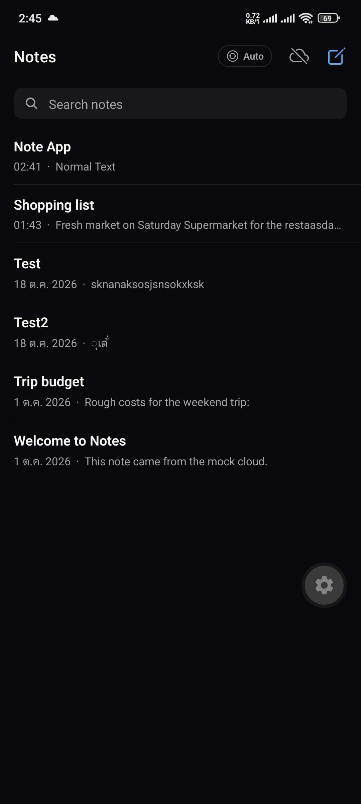
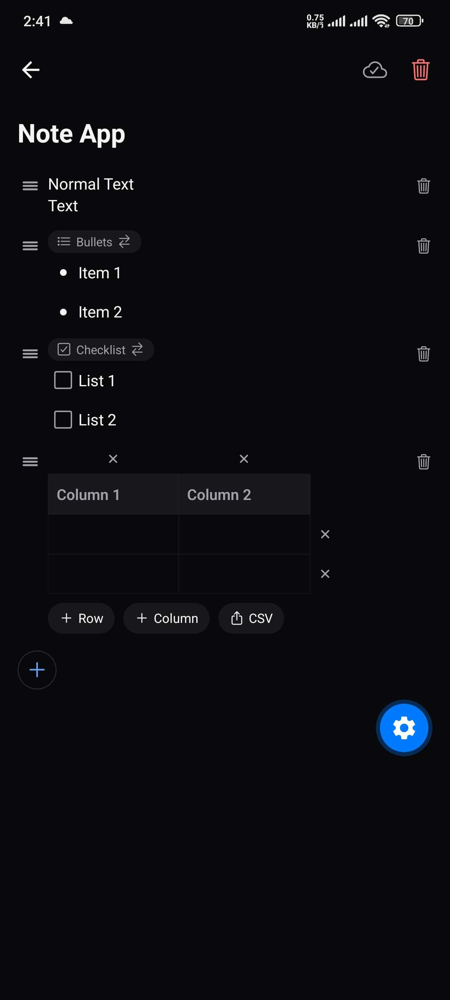
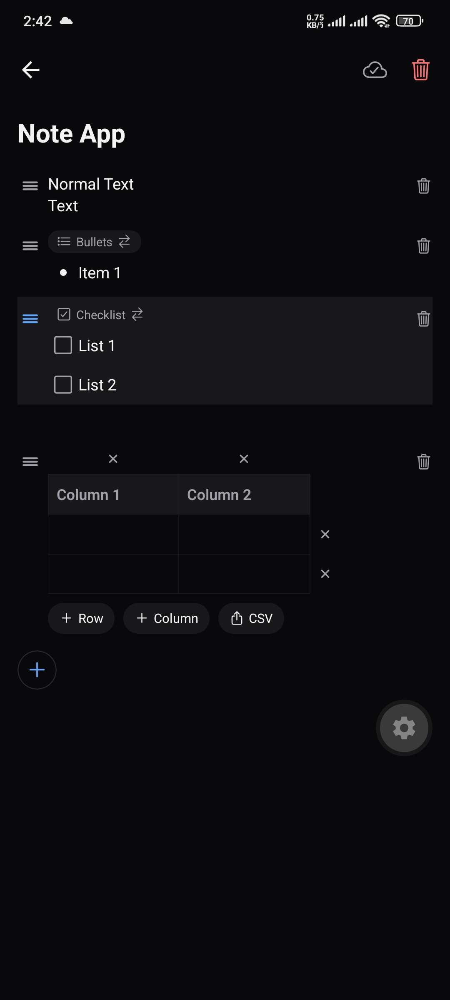

# StackNote

A block-based note-taking app with local-first storage and REST sync. Notes are made of text, list
(bullet or checkbox) and table blocks. Every edit is saved on the device first and synced to a server
afterwards, so the app keeps working offline.

The server is a local mock of a cloud backend, built to develop and test the sync logic. It is not a
deployed service.

| Note list | Editor | Drag to reorder |
|---|---|---|
|  |  |  |

## Features

- Text, bullet list, checklist and table blocks
- Drag to reorder blocks
- Search across notes
- Export a table to CSV
- Offline editing, with a sync status indicator (synced / syncing / offline / error)
- Sync on app start, on return to the foreground and after typing stops, plus an optional auto sync

## Tech stack

| Part | Technology |
|---|---|
| App | React Native, Expo SDK 57, TypeScript (strict), expo-router, zustand, AsyncStorage |
| Server | Node.js, Express, SQLite (better-sqlite3, WAL mode), zod |

## How sync works

1. An edit is saved locally and the note is marked dirty.
2. Dirty notes are pushed with `PUT /notes/:id`.
3. Changes since the last sync are pulled with `GET /notes?since=<ms>` and merged.

- **Conflicts:** last-write-wins by `updatedAt`. The server only accepts a note that is newer than its copy.
- **Deletes:** soft deletes, so other devices learn about them.
- **Failures:** a failed sync keeps the local data and the note stays dirty for the next attempt.
- **Server access:** the UI and stores only talk to a `CloudAdapter` interface, so the mock can be replaced
  without changing them.

## Getting started

You need Node.js. To run on a phone, you also need Expo Go (SDK 57) and the same Wi-Fi as the computer.

**1. Start the server**

```bash
cd mock-cloud
npm install
npm run dev        # listens on 0.0.0.0:4000
npm run db:seed    # optional: adds sample notes
```

**2. Start the app**

```bash
cd app
npm install
cp .env.example .env    # then set EXPO_PUBLIC_API_URL
npx expo start          # scan the QR code with Expo Go
npx expo start --web    # or run in the browser
```

A phone must use the computer's LAN IP in `EXPO_PUBLIC_API_URL`, and port 4000 must be allowed through the
firewall. The web build can use `http://localhost:4000`.

**Simulating a bad network:** set `MOCK_DELAY_MS` and `MOCK_FAIL_RATE` (0–1) when starting the server to
add latency and random failures.

## Project structure

```
app/          Expo app; source in app/src (screens, block components, stores, sync engine)
mock-cloud/   Express + SQLite server; source in mock-cloud/src, database scripts in mock-cloud/scripts
screenshots/  Images used in this README
```

See [`app/README.md`](app/README.md) and [`mock-cloud/README.md`](mock-cloud/README.md) for details.

## Testing

Testing was manual; there is no automated test suite yet.

- **App:** tested in Chrome and on one Android device with Expo Go. Not tested on iOS.
- **API:** missing tokens, malformed data and stale updates, checked with curl.
- **Sync:** two devices simulated with browser tabs using separate storage, covering conflicts and deletes.
  Also tested with `MOCK_FAIL_RATE=0.5`: retries succeeded and no data was lost.

## Known limitations

- Last-write-wins applies to the whole note. If two devices edit the same note before syncing, the older
  version is lost even when they changed different blocks.
- Conflict resolution relies on device clocks, so a large clock difference can pick the wrong version.
- Authentication is a fixed mock token, and traffic is plain HTTP.
- On Android, a block that was just dragged can briefly render in the wrong position. The saved order is correct.
